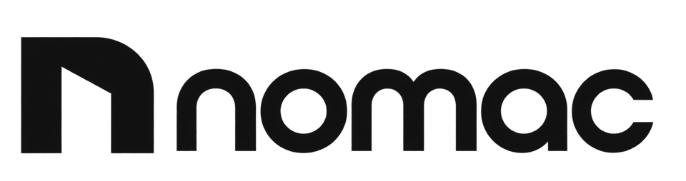
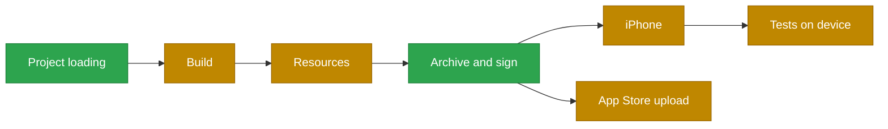

<p align="center">
  <picture>
    <source media="(prefers-color-scheme: dark)" srcset="docs/assets/logo-dark.png">
    
  </picture>
</p>

<p align="center"><b>Build iOS apps from Xcode projects on Linux, without a Mac.</b></p>

Early preview. Supports Xcode 27.0 (27A266a), iOS devices only.

## Installation

On Ubuntu 24.04 (x86_64 or arm64), with your own Xcode 27.0 download:

```sh
curl -fsSL https://raw.githubusercontent.com/khzouroussama/nomac/main/install.sh | bash
nomac sdk install ~/Downloads/Xcode_27.xip    # or an Xcode.app
nomac toolchain install
nomac doctor
```

Building from source and what the installer does: [docs/INSTALL.md](docs/INSTALL.md).

## Usage

```
$ nomac --help
OVERVIEW: Build, sign and install iOS apps from Xcode projects on Linux.

Commands take xcodebuild's flags; 'nomac <command> --help' shows each one's.
The tools of Xcode that builds run (actool, ibtool, momc and others) are nomac
commands too, not listed here.

USAGE: nomac <subcommand>

OPTIONS:
  --version               Show the version.
  -h, --help              Show help information.

SUBCOMMANDS:
  build                   Build a scheme or target, as 'xcodebuild build'.
  archive                 Archive a scheme, as 'xcodebuild archive'.
  export                  Export an archive to an IPA.
  codesign                Sign bundles and Mach-O files, as 'codesign'.
  check                   List what a project uses that nomac has not verified.
  list                    List targets and schemes, as 'xcodebuild -list'.
  inspect                 Print build settings (-showBuildSettings).

DEVICES AND APP STORE SUBCOMMANDS:
  device                  List and check devices, and read crash reports.
  install                 Install an app on a device.
  uninstall               Remove an app from a device.
  launch                  Launch an installed app on a device.
  stop                    Stop an app running on a device.
  run                     Archive, install and launch on a device.
  test                    Run an .xctestrun's tests on a device.
  atos                    Symbolicate addresses, as 'atos -i'.
  upload                  Upload an IPA to App Store Connect.

SETUP SUBCOMMANDS:
  sdk                     Install and select your Xcode's SDKs.
  toolchain               Install the Swift toolchain nomac builds with.
  doctor                  Check the installed Xcode and tools.

VERIFICATION SUBCOMMANDS:
  verify                  Compare nomac's output for an app with Xcode's.
  products                Compare two Build/Products folders.
  pif                     Write the project as Swift Build reads it (PIF).
  corpus                  Work with the verification corpus.

  See 'nomac help <subcommand>' for detailed help.
```

```sh
# Check what a project uses that nomac does not support yet
nomac check App.xcworkspace

# Build a scheme
nomac build -workspace App.xcworkspace -scheme App -destination generic/platform=iOS

# Archive it
nomac archive -workspace App.xcworkspace -scheme App -destination generic/platform=iOS \
    -archivePath App.xcarchive

# Export an IPA
nomac export -archivePath App.xcarchive -exportPath out \
    -exportOptionsPlist ExportOptions.plist

# Install and launch on an iPhone connected by USB
nomac install out/App.ipa --device <UDID>
nomac launch com.example.App --device <UDID>

# Compare nomac's output with Xcode's
nomac verify <reference> --source . --developer-dir <Xcode.app>/Contents/Developer
```

The commands take xcodebuild's flags. Run `nomac <command> --help` for each one.

## Status



Measured on real open-source apps against Xcode 27's output; details in [docs/PROGRESS.md](docs/PROGRESS.md).

Works with React Native and Expo apps: a fresh React Native 0.88 app and a fresh Expo SDK 58 app
(with one line changed in Expo's autolinking) build, install and run on an iPhone from Linux
([docs/DEMO.md](docs/DEMO.md)). Of 58 public React Native and Expo apps that install and that
Xcode builds, 46 reach an IPA.

`nomac test` runs an app's unit tests on an iPhone from Linux; UI tests not yet.

Apps nomac never saw:

| Area | | Result |
|---|---|---|
| React Native and Expo apps to an IPA | `████████░░` | 46 / 58 |
| Projects read as Xcode reads them | `██████████` | 19 / 19 |

The 20 apps nomac was developed against:

| Area | | Result |
|---|---|---|
| Apps that build end to end on Linux | `█░░░░░░░░░` | 2 / 20 |
| Projects read as Xcode reads them | `██████████` | 19 / 19 measured (signal pending) |
| Build products | `████████░░` | 929 / 1,198 |
| Storyboards and xibs | `██████░░░░` | 271 / 485 |
| Asset catalogs | `█████░░░░░` | 54 / 99 |
| PDF images | `████████░░` | 1,287 / 1,535 |
| Strings | `██████████` | 3,022 / 3,022 |
| Core Data models | `██████████` | 11 / 11 |
| Signing and export | `██████████` | 12 / 12 |

## How it works

nomac drives Apple's open-source [Swift Build](https://github.com/swiftlang/swift-build), the
engine inside Xcode. It reimplements the parts Xcode keeps closed, such as reading `.xcodeproj`
files, `actool`, `ibtool` and `momc`, from their observed outputs. It uses patched forks of
[Swift Build](https://github.com/khzouroussama/swift-build) and
[swift-driver](https://github.com/khzouroussama/swift-driver), which SwiftPM fetches by itself.

## How nomac compares

xtool builds SwiftPM-based apps on Linux. zsign, rcodesign and libimobiledevice sign and install
from Linux. EAS Build, Codemagic, Bitrise, GitHub's macOS runners and EC2 Mac run Xcode on rented
Macs. nomac takes your existing `.xcodeproj`, with its storyboards, asset catalogs and CocoaPods,
and builds it on Linux. Details: [docs/COMPARISON.md](docs/COMPARISON.md).

## Legal

nomac includes no Apple software; you use your own Xcode download. It is written from observed
outputs and public documentation, never from decompiling. Apple's Xcode and Apple SDKs Agreement
authorizes Apple's software only on Apple-branded computers running macOS, and you are
responsible for complying with it. nomac was developed and tested on Macs. nomac is not affiliated
with Apple; Xcode, iOS and TestFlight are trademarks of Apple Inc. Read
[docs/LEGAL.md](docs/LEGAL.md).

## Contributing

See [CONTRIBUTING.md](CONTRIBUTING.md); AI coding agents start from [AGENTS.md](AGENTS.md).

## Documentation

- [docs/INSTALL.md](docs/INSTALL.md): installation and building from source
- [docs/INSTALL-ON-IPHONE.md](docs/INSTALL-ON-IPHONE.md): signing, installing and launching on an iPhone
- [docs/EXAMPLES.md](docs/EXAMPLES.md): an open-source app from clone to IPA
- [docs/DEMO.md](docs/DEMO.md): a React Native and an Expo app on Linux
- [docs/PROGRESS.md](docs/PROGRESS.md): what is measured, on which apps
- [docs/COMPARISON.md](docs/COMPARISON.md): other tools
- [docs/LEGAL.md](docs/LEGAL.md): Apple's terms and how nomac is written
- [CONTRIBUTING.md](CONTRIBUTING.md) and [AGENTS.md](AGENTS.md): working on nomac
- [docs/ARCHITECTURE.md](docs/ARCHITECTURE.md): how it fits together

## License

Apache License 2.0 (LICENSE). Third-party licenses are in NOTICE.

Uses your own Xcode download; read [docs/LEGAL.md](docs/LEGAL.md).
